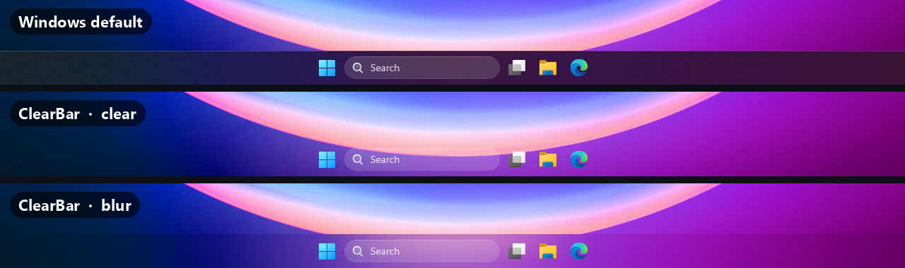
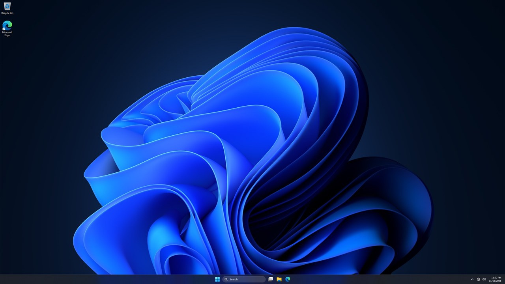
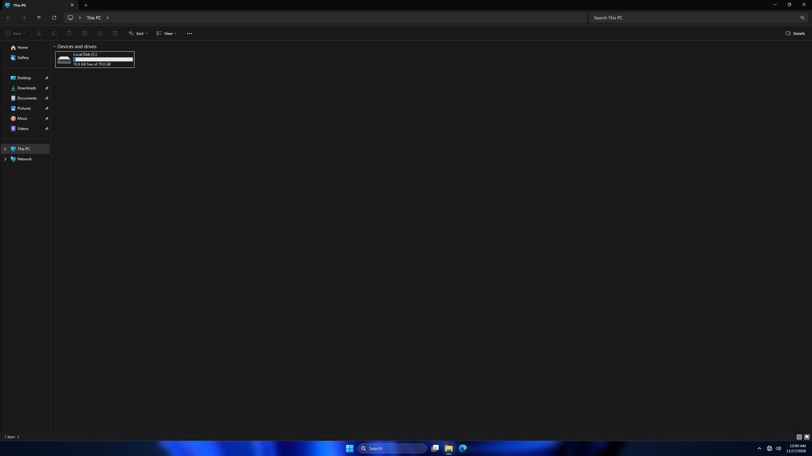
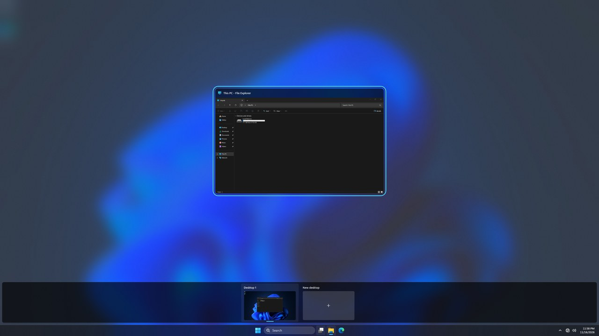

<h1 align="center">ClearBar</h1>

<p align="center">
  <b>A tiny, private, open-source way to make the Windows 11 and Windows 10 taskbar see-through or softly blurred.</b><br>
  No UI. No tray icon. No network. ~1.4 MB of RAM. Starts with Windows and stays out of your way.
</p>

<p align="center">
  <a href="https://github.com/Raff407/ClearBar/releases/latest"></a>
  <a href="https://github.com/Raff407/ClearBar/actions/workflows/build.yml"></a>
  
  <a href="LICENSE"></a>
</p>

<p align="center">
  
</p>

---

## See it



<table>
<tr>
<td width="50%"></td>
<td width="50%"></td>
</tr>
<tr><td align="center">Before: Windows default</td><td align="center">After: ClearBar <code>clear</code></td></tr>
<tr>
<td width="50%"></td>
<td width="50%"></td>
</tr>
<tr><td align="center">Maximised window: <code>blur</code> + line (optional mode)</td><td align="center">Task View: Windows' <code>normal</code> look (on by default)</td></tr>
</table>

<sub>Screenshots from a clean Windows 11 install (Windows Sandbox, default wallpapers and dark theme). The look switches instantly when the mode changes.</sub>

## Why ClearBar?

ClearBar does one job, making the taskbar **clear** or **blurred**, and does it with almost no resources. Everything else is cut.

<table>
<tr><th align="left">Metric</th><th>TranslucentTB 2026.2</th><th>ClearBar 1.0</th><th>Difference</th></tr>
<tr><td>Private memory (RAM)</td><td>61.5 MB</td><td><b>1.4 MB</b></td><td><b>~44× less</b></td></tr>
<tr><td>Working set</td><td>79 MB</td><td><b>~8 MB</b></td><td><b>~10× less</b></td></tr>
<tr><td>Background CPU</td><td>0.2% avg over a 12.9 h session (0.47% in a 10 s sample)</td><td><b>not measurable</b>&nbsp;¹</td><td>effectively zero</td></tr>
<tr><td>Threads</td><td>26</td><td><b>1–4</b></td><td><b>~6–26× fewer</b></td></tr>
<tr><td>Handles</td><td>635</td><td><b>108</b></td><td><b>~6× fewer</b></td></tr>
<tr><td>DLL loaded into Explorer</td><td>553 KB</td><td><b>267 KB</b></td><td><b>~2× smaller</b></td></tr>
<tr><td>Download</td><td>1.77 MB (portable zip) / 4.17 MB (Store bundle)</td><td><b>247 KB</b></td><td><b>~7–17× smaller</b></td></tr>
<tr><td>Installed size</td><td>—</td><td><b>~480 KB</b></td><td></td></tr>
<tr><td>Network code</td><td>none</td><td><b>none</b></td><td>same</td></tr>
<tr><td>Settings UI / tray icon</td><td>yes</td><td>no (one text file)</td><td>trade-off</td></tr>
</table>

<sub>Measured on one PC: Windows 11 build 26300, two monitors, both tools set to a clear taskbar, figures taken from Windows' own process counters. ¹ With the default config (window tracking off), ClearBar used 0 ms of CPU time over a 60-second idle window, and moving the mouse 3,000 times did not register either. Windows counts CPU time in 15.6 ms ticks, so that means less than 0.03%. With window tracking on it also stayed at 0 ms for 3,000 mouse moves and 20 s idle. Your numbers will vary.</sub>

**Where the savings come from:** TranslucentTB keeps a full XAML/WinUI settings UI and tray menu loaded at all times, and listens to about a dozen system-wide window events, including mouse-driven ones. ClearBar has no UI at all. By default it listens only for foreground-window and cloak changes, so it sleeps until something it cares about happens.

> TranslucentTB is a great, mature project. It inspired ClearBar and it does far more (colours, acrylic, rules, a GUI). ClearBar is for people who want *just* the transparent look with the smallest possible footprint.

## Features

- **`clear`**: a fully see-through taskbar.
- **`blur`**: see-through with a soft blur of whatever is behind the bar, with no tint. On Windows 11 it is a real Gaussian blur with adjustable strength (1–50) that **still works with "Transparency effects" switched off**. On Windows 10 it is Windows' own system blur, whose strength is fixed.
- **`normal`**: Windows' own look, for example while Task View is open.
- **Dynamic modes**: different looks on the desktop, with a window open, with a maximised window, or with Start, Search or Task View open. Each mode is per monitor.
- **The taskbar line** (Windows 11): show or hide the thin line along the top of the taskbar, per mode. Windows 10's taskbar has no such line.
- **Windows 11 and Windows 10**: Windows 10 version 2004 to 22H2 is supported too, with the same looks and modes.
- **Multi-monitor**: every taskbar is handled independently.
- **Self-healing**: re-applies itself after Explorer restarts, and after waking from sleep, unlocking and display changes. If ClearBar exits, the taskbar goes straight back to normal; on Windows 11 that also happens if it crashes.

## Install (one time, ~10 seconds)

Requires **Windows 11**, or **Windows 10 version 2004 to 22H2** (build 19041–19045, including LTSC 2021), on **x64**. ARM64 and Windows Server aren't supported.

1. Download **`ClearBar-v1.1.0-x64.zip`** from the [latest release](https://github.com/Raff407/ClearBar/releases/latest).
2. Extract it anywhere (right-click → **Extract All**). Your Downloads folder is fine: the installer copies what it needs.
3. Double-click **`Install.cmd`**.

That's it. The taskbar goes clear straight away, and ClearBar starts by itself every time you sign in.

- No administrator rights needed. It installs for your user only, into `%LOCALAPPDATA%\Programs\ClearBar`.
- If Windows asks *"Do you want to run this file?"*, click **Run**. That appears because the files came from the internet. To avoid it, right-click the zip → **Properties** → tick **Unblock** before extracting.
- **Already using TranslucentTB?** Quit it from its tray icon and turn off its entry in *Task Manager → Startup apps* before installing. Two tools can't control the same taskbar.

**Uninstall:** *Settings → Apps → Installed apps → ClearBar → Uninstall* (on Windows 10: *Settings → Apps → Apps & features*), or double-click `Uninstall.cmd` in the extracted zip. It removes the startup task, the Installed-apps entry and all files. On Windows 11, Explorer restarts once at the end, so the taskbar disappears for a few seconds and comes back normal; on Windows 10 no restart is needed.

**Update:** extract the new zip and run its `Install.cmd`. Your settings are kept. On Windows 11, if the helper DLL changed, Explorer restarts once so the new version can load, and the taskbar disappears for a few seconds (1.0 → 1.1 keeps the same DLL, so no restart).

## Configure

Open **`%LOCALAPPDATA%\Programs\ClearBar\config.ini`** (paste that into the Explorer address bar) in any text editor. **Changes apply the moment you save.** No restart needed.

```ini
[desktop]            ; the look most of the time
accent = clear       ; clear | blur | normal
blur = 8             ; 1-50, used when accent = blur (Windows 11; Windows 10's blur is fixed)
show_line = false    ; the thin line along the top of the taskbar (Windows 11 only)

[task_view_opened]   ; optional modes: enabled = true | false
enabled = true
accent = normal
show_line = true
```

**Want blur everywhere?** Set `accent = blur` under `[desktop]`, then save.

| Section | Applies when | Default |
|---|---|---|
| `[desktop]` | always (the fallback) | `clear`, no line |
| `[visible_window]` | any window is open on that monitor | off |
| `[maximized_window]` | a window is maximised on that monitor | off (`blur` + line when enabled) |
| `[start_opened]` | the Start menu is open | off |
| `[search_opened]` | Search is open | off |
| `[task_view_opened]` | Task View is open | **on**: `normal` + line |

When several apply, the highest wins: Task View → Start → Search → maximised window → visible window → desktop.

Window tracking is only switched on when `visible_window` or `maximized_window` is enabled, so the default setup costs nothing extra.

## Privacy & security

- **No network code at all.** No telemetry, no analytics, no crash reporting, no update checks. Nothing it does leaves your PC.
- **No admin rights.** It runs as you, with normal permissions.
- **Small, readable source.** About 2,500 lines of C++ in [`src/`](src). Release binaries are built by [GitHub Actions](.github/workflows/build.yml) from the tagged source, with a SHA-256 checksum next to each zip.
- **What it touches:** its files in `%LOCALAPPDATA%\Programs\ClearBar` (`ClearBar.exe`, `ClearBarTap.dll`, `uninstall.ps1`, `config.ini`), 1 Task Scheduler entry named `ClearBar`, and its own *Installed apps* entry under `HKCU\…\Uninstall\ClearBar`. Nothing else: no system-wide registry changes, no services, no drivers. Uninstalling removes all of it.
- **How it changes the taskbar:** Windows 11 draws its taskbar with XAML. ClearBar loads a small helper (`ClearBarTap.dll`) into Explorer. It uses the documented XAML diagnostics interface ([`InitializeXamlDiagnosticsEx`](https://learn.microsoft.com/windows/win32/api/xamlom/nf-xamlom-initializexamldiagnosticsex)), the same one Visual Studio's Live Visual Tree uses, to swap the taskbar's background brush. TranslucentTB and Windhawk use the same XAML diagnostics approach.
  - **How it loads:** ClearBar sets a no-op `WH_GETMESSAGE` hook (`SetWindowsHookEx`) on the taskbar's thread only. Explorer loads the helper, and the hook is removed as soon as the helper reports ready.
  - **A known XAML crash:** XAML's composition diagnostics have a heap-corruption bug. To avoid it, the helper patches `Windows.UI.Xaml.dll`'s import table **in memory** (nothing on disk), so XAML reads `DisableCompositionDiag = 1` on ClearBar's own setup thread. Calls from every other thread pass through unchanged.
  - It never modifies Windows' files and never writes to the registry from Explorer.
- **On Windows 10** nothing is loaded into Explorer at all. Windows 10 draws its taskbar with DWM, so `ClearBar.exe` sets the taskbar windows' *accent policy* from its own process with `SetWindowCompositionAttribute` (the API TranslucentTB uses on Windows 10) and restores Windows' look by asking Explorer to re-apply its own. `ClearBarTap.dll` is installed but never used there.
  - Explorer sometimes re-applies its own look, typically while a shell window (Start, Search, a theme change) opens. ClearBar puts its look back within a fraction of a second after such events, using a few short one-off timers, never a polling loop. In testing, no reset was visible to a 60 Hz screen sampler.
  - If ClearBar is killed rather than closed, the taskbar keeps ClearBar's look until Explorer next redraws it in its own style (Explorer restart, sign-out, theme change). `ClearBar.exe --exit` and uninstalling restore it straight away.
- **Logs:** two optional debug logs, `clearbar.log` and (Windows 11 only) `tap.log`, are written to the same folder only when `debug_log = true` is set under `[general]`. They are off by default. The one exception is a single warning line if `ClearBar.exe` and the helper DLL are mismatched versions.

## How it works

```
 ClearBar.exe  (hidden, event-driven)            explorer.exe
 ├─ reads config.ini (hot reload)                 └─ ClearBarTap.dll
 ├─ listens for window / Start / Task View events    ├─ watches the taskbar's XAML tree
 ├─ decides a look per taskbar                       ├─ sets Rectangle#BackgroundFill  (clear / blur / normal)
 └─ publishes it ── shared memory (seqlock) ──────►  ├─ sets Rectangle#BackgroundStroke (the top line)
                                                     └─ restores Windows' look if ClearBar.exe exits
```

- **`blur`:** a custom XAML brush that feeds a Composition backdrop brush through Direct2D's Gaussian blur effect (Windows 11).
- **Windows 10:** no helper in Explorer. `ClearBar.exe` sets each taskbar's accent policy itself (`clear` = transparent gradient with alpha 0, `blur` = DWM blur-behind) and re-applies it after shell events.
- **Explorer restarts:** ClearBar waits until the new taskbar is ready, then reconnects. The look returns a few seconds after the taskbar reappears.
- **Explorer fighting back:** if Explorer resets the brush (theme change, monitor sleep), the helper re-applies it. It backs off if Explorer keeps fighting, so it can never burn CPU.

## Build from source

You need Visual Studio 2022 or newer (or the Build Tools) with **Desktop development with C++** and a Windows 11 SDK.

```bat
:: Build -> out\ClearBar.exe, out\ClearBarTap.dll, out\tests.exe
build.cmd
:: Run the 120 unit checks
out\tests.exe
:: Install your own build
powershell -ExecutionPolicy Bypass -File install.ps1
:: Package -> dist\ClearBar-v*-x64.zip
powershell -ExecutionPolicy Bypass -File package.ps1
```

### Tests

| Suite | What it checks |
|---|---|
| `out\tests.exe` | 120 unit checks: config parser, mode priority, window classification (Windows 11 and 10), the Windows 10 accent mapping and version gate, shared-memory protocol, and a 400,000-write concurrency stress test |
| `tests\import_check.py` | Fails the build if a binary imports an API that Windows 10 2004 doesn't have |
| `tests\vm\win10_live.ps1` | Windows 10 live suite, meant for a throwaway VM: clear / blur / normal, Explorer resets during Start, Search, Action Center, Alt+Tab, theme and transparency switches (sampled at ~60 Hz), every mode, `--exit`, Explorer restart |
| `tests\blur_test.ps1` | Live, no keyboard input, over a striped test pattern: clear shows the stripes, blur greys them out, blur strength, the line toggle, 20 clear↔blur flips, crash → restore, restart → re-apply |
| `tests\live_test.ps1` | Live, drives the keyboard: Search, Task View, maximised and visible windows (on a temporary virtual desktop), hot reload, `--exit`, Explorer restarts, starting before the taskbar exists |
| `tests\perf_test.ps1` | Idle CPU, CPU while moving the mouse, and Explorer memory/handle leak checks over hundreds of changes and restarts |

The live suites test the build in `out\` by default. Pass `-Stage <folder>` to test another copy, e.g. the installed one.

Run the live suites when you're not using the PC. They flash the taskbar and open Search and Task View.

## FAQ

<details><summary><b>Windows 10?</b></summary>
Yes, version 2004 to 22H2 (build 19041–19045, including LTSC 2021), since ClearBar 1.1. The looks and modes are the same, with two differences: <code>blur</code> uses Windows 10's own blur, whose strength is fixed, and there is no top line to show or hide. Windows 10 support was tested on a Windows 10 22H2 virtual machine, where ClearBar used 1.1 MB of private memory, one thread and 0 ms of CPU over a minute idle. Older Windows 10 versions (1909 and earlier, LTSC 2019) aren't supported.
</details>

<details><summary><b>Smart App Control blocks it</b></summary>
Smart App Control blocks unsigned apps and DLLs, and ClearBar's binaries are not code-signed. Building from source doesn't help, because local builds are unsigned too. To use ClearBar you have to turn Smart App Control off (*Windows Security → App &amp; browser control → Smart App Control*). On older Windows 11 builds, turning it back on later may require a Windows reset.
</details>

<details><summary><b>It stopped working after a big Windows update</b></summary>
Microsoft sometimes changes the taskbar's internals, which affects every tool of this kind. Restart Explorer or sign out and in again. If it still doesn't work, please <a href="https://github.com/Raff407/ClearBar/issues">open an issue</a> with your Windows build number (<code>winver</code>).
</details>

<details><summary><b>Start opens and "search_opened" applies, not "start_opened"</b></summary>
On some recent Windows 11 builds, Start is hosted by the Search process, so the two can't be told apart. Windows 10 tells them apart.
</details>

<details><summary><b>Can I run it alongside TranslucentTB / Windhawk taskbar mods?</b></summary>
Not alongside anything that also changes the taskbar background. They would keep overriding each other.
</details>

<details><summary><b>Commands</b></summary>
<code>ClearBar.exe --exit</code> stops it, and the taskbar restores instantly. <code>ClearBar.exe --reload</code> forces a full re-apply.
</details>

## Acknowledgements

- [TranslucentTB](https://github.com/TranslucentTB/TranslucentTB) and [Windhawk's Windows 11 Taskbar Styler](https://github.com/ramensoftware/windhawk-mods) showed how the Windows 11 XAML taskbar can be styled from the outside. ClearBar's injection and blur approach builds on that public work, and its Windows 10 support uses the accent-policy technique TranslucentTB has long used there.
- ClearBar is not affiliated with either project or with Microsoft.

## License

[GPL-3.0-or-later](LICENSE). Free to use, study, change and share.
